# Automatic Soldering of Through-Hole Components with ABB YuMi

Automated soldering of through-hole (THD) components on PCBs with the **ABB YuMi (IRB 14000)** collaborative robot, a 3D-printed soldering-iron mount and a custom solder-wire feeder and cleaner.
The software pipeline goes from *"click the pins you want soldered"* to a ready-to-run **RAPID** program. Selected joints are mapped to robot coordinates using a calibrated point dataset, then ordered by **Ant Colony Optimization (ACO)** to minimise travel between joints.

> Bachelor thesis, VNU University of Engineering and Technology, MEMS and Microsystems Department (2024).
> Author: **Nguyen Huyen Trang**. Supervisors: Assoc. Prof. Bui Thanh Tung, MSc. Tran Nhu Chi.

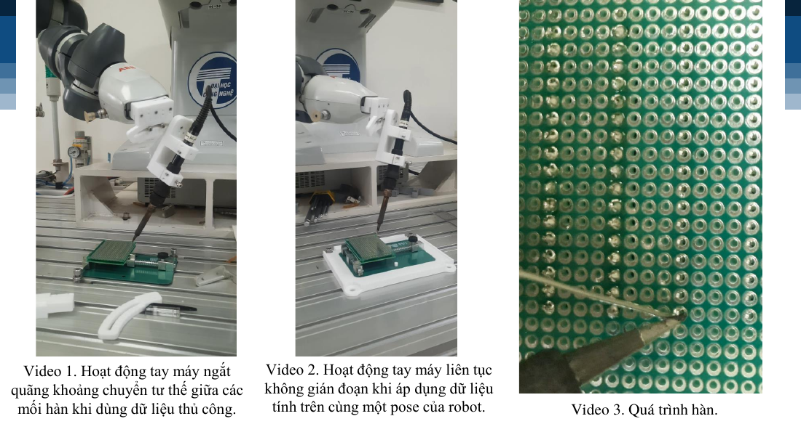

## Highlights

| | Result |
| --- | --- |
| Solder defects | **55 % empty joints → 6.7 % overall defect rate** (first trial vs. final parameters) |
| Wrong-position rate | **58.5 % → 10.2 %** of points (manual teaching vs. selective approximation) |
| Hole-pitch error | **1.305 mm → 0.022 mm** (manual teaching vs. selective approximation) |
| Re-setup time for a new board | **Hours → ≈ 4 min** (dataset + calibration instead of re-teaching every point) |
| Path optimization (Berlin52 benchmark) | Unordered tour **16,751 → 7,542** with ACO, the known optimum |
| RAPID programming | **Fully generated**, with no manual editing of point names or calls |

## Contents

0. [Overview](#0-overview)
1. [Hardware](#1-hardware)
2. [Software setup](#2-software-setup)
3. [Working procedure (how to run)](#3-working-procedure)
4. [Experiments and results](#4-experiments-and-results)
5. [Limitations and future work](#5-limitations-and-future-work)

---

## 0. Overview

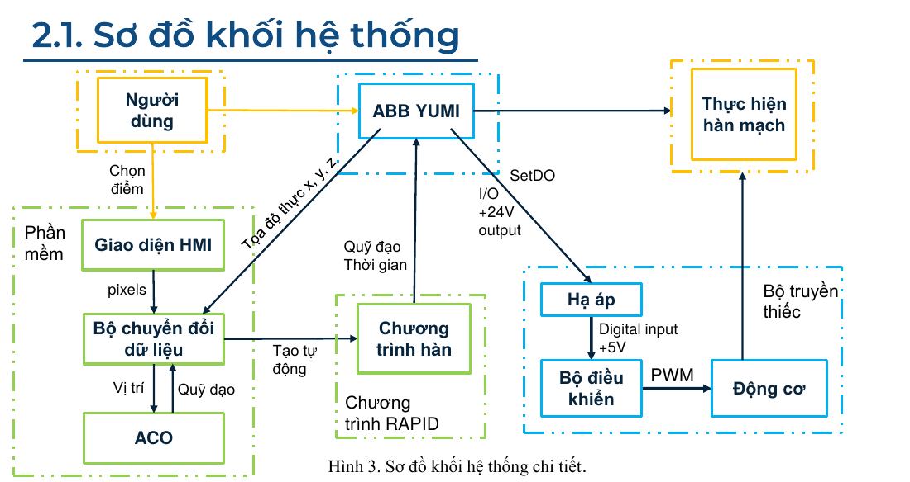

The system has three groups of blocks:

- **Software (green):** the web input page, the data processor, the ACO path optimizer and the RAPID program generator
- **Actuation (blue):** the YuMi right arm and the solder feeder
- **Operator (orange):** selects joints, jogs the robot with the FlexPendant and starts the program

**Data flow.** Joints selected on the web page come out as pixels. The processor converts them to `(row, col)` holes, and ACO orders them. The generator merges point data, the solder `PROC` and the `main()` calls into one RAPID module. During the run, YuMi raises a 24 V digital output at each joint. A logic step-down converts it to 5 V, and the feeder controller drives the motor to push solder wire.

### Repository structure

```
.
├── web_pcb_selector/        # HTML/JS page for picking joints (3×7 … 8×12 cm boards)
├── data_processing/
│   ├── pixel_to_grid.py     # pixel coords → (row, col), de-duplication
│   ├── build_dataset.py     # reference robtargets → full hole grid in robot frame
│   ├── calib.py             # shift the coordinate origin to the actual board position
│   └── selective_approx.py  # approximate a full grid of joints in xyz coordinates
├── aco/
│   ├── aco_tsp.m            # ACO / TSP solver (MATLAB, used for reported results)
│   └── aco_tsp.py           # Python version, used for plotting
├── rapid/
│   ├── proc.txt             # solder-cycle PROC for one joint
│   └── merge_rapid.py       # dataset + proc + cmd → one RAPID module
├── firmware/
│   ├── cad/                 # iron mount, PCB fixture, feeders, cleaner (STEP/STL)
│   ├── cleaner_esp32/       # ESP32 + Nidec 24H BLDC
│   │   ├── schematic/
│   │   └── code/
│   ├── feeder_v1_esp32/     # ESP32 + Nidec 24H BLDC
│   │   ├── schematic/
│   │   └── code/
│   └── feeder_v2_mega/      # Arduino Mega 2560 + TB6600 + NEMA14 (final)
│       ├── schematic/
│       └── code/
└── docs/images/
```

---

## 1. Hardware

### 1.1 Work-cell setup

A fixture plate holds the PCB in a repeatable position in front of the YuMi right arm. Test boards are double-sided perfboards (2.54 mm pitch) with jumper pins in consecutive rows. Pins should protrude **2 mm or less** and be held in place by bending the leads or taping them.

### 1.2 Soldering-iron mount

The mount bolts to the camera face of the YuMi wrist. A curved slotted bracket lets you set the iron angle. The final setup uses the **iron at 60° from vertical**, with the solder nozzle horizontal on the opposite side of the pin. All parts are 3D-printed. Leave clearance for M2 screw holes, because 0.4 mm nozzles shrink holes by about 0.2–0.5 mm.

| CAD | First and second builds |
| --- | --- |
| 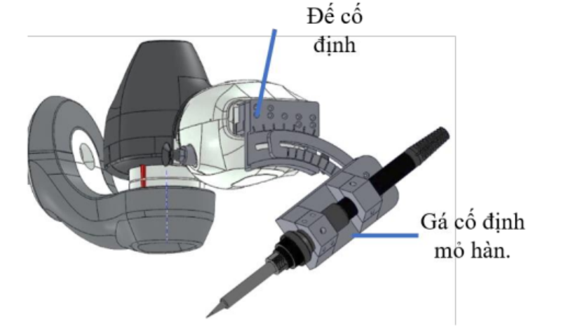 | 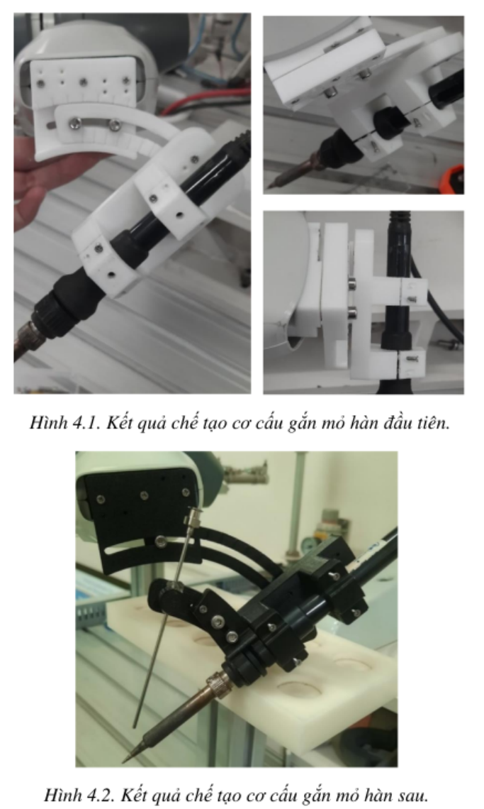 |

### 1.3 Solder feeder v1 (ESP32 + BLDC)

The wire is pinched between a motor-driven gear and a ball bearing, guided by four brass posts. It only fits **0.8 mm** wire.

| Model | Build | Controller |
| --- | --- | --- |
| 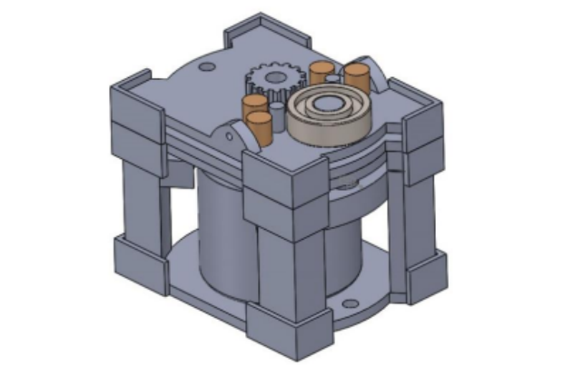 | 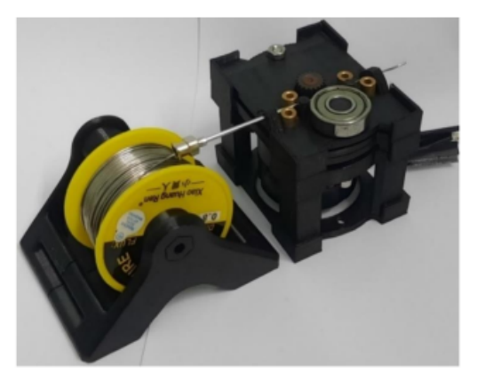 | 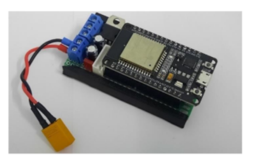 |

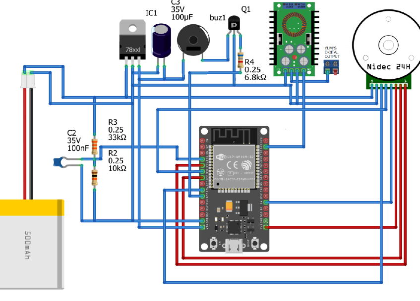

- **Controller:** ESP32 driving a **Nidec 24H055M020** BLDC motor with built-in driver and encoder (PWM speed control)
- **Power:** 12 V for the motor; a 7805 regulator supplies 5 V to the ESP32
- **Input:** YuMi digital output (0/24 V) through a voltage divider and step-down converter
- **Problems found:** wire slipping and sudden jerks at start-up. These caused most of the "insufficient solder" defects in early tests.
- **Code:** `firmware/feeder_v1_esp32/`

### 1.4 Solder feeder v2 (Arduino Mega + stepper), final version

This version is based on a 3D-printer filament extruder. A **9:5:1 spur-gear train** drives a grooved pulley, and a spring-loaded screw sets the clamping force. It handles wire from **0.3 to 1.2 mm**. The groove keeps bent wire from slipping and reduces solder spatter.

| Gear train | Build |
| --- | --- |
| 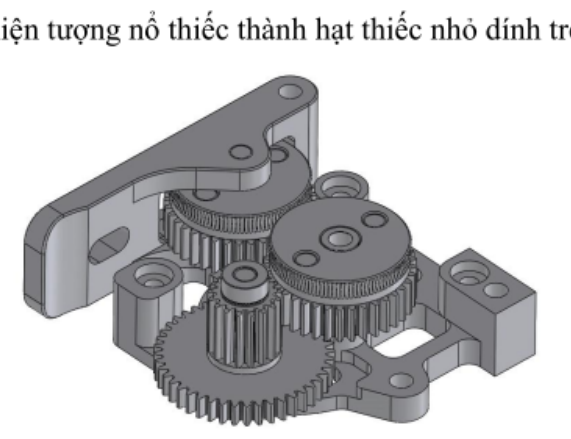 | 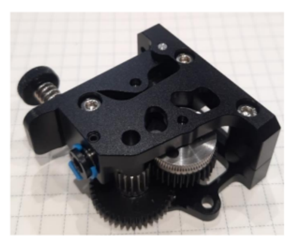 |

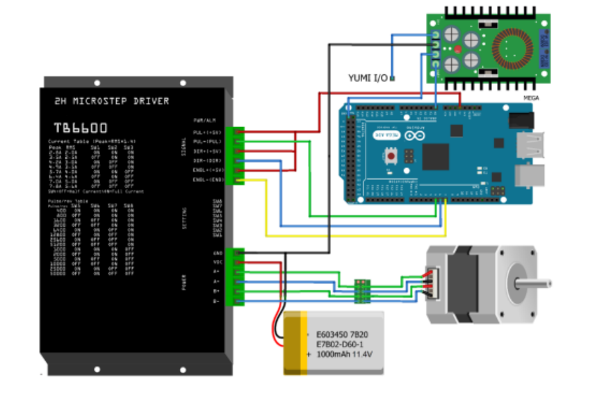

- **Controller:** Arduino Mega 2560 with a **TB6600** micro-step driver and a **NEMA14 36STH20-1004AHG** stepper, which gives slow and precise feed rates
- **Power:** 12 V to the driver and 5 V to the Mega
- **Input:** YuMi I/O through a 24 V → 5 V step-down
- **Code:** `firmware/feeder_v2_mega/`

---

## 2. Software setup

**Requirements**
- ABB RobotStudio (RobotWare with RAPID) connected to the YuMi controller
- Python 3.8+ with `numpy` and `matplotlib`
- MATLAB R2020+ (recommended for ACO, which ran much faster than the Python version)
- Arduino IDE (ESP32 core for v1)

```bash
git clone https://github.com/nht-cyb/yumi-automatic-soldering-thd.git
cd yumi-automatic-soldering-thd
pip install numpy matplotlib
```

### 2.1 Start pose

Jog the right arm with the FlexPendant joystick to a home pose. The wrist camera must face straight down at the board, perpendicular to the table. Adjust joints 4–6 to get there. With this pose fixed, pure linear jogging moves the iron tip along board rows and columns without changing the tool angle.

| J1 | J2 | J3 | J4 | J5 | J6 | J7 |
| --- | --- | --- | --- | --- | --- | --- |
| 54.64° | -98.48° | 25.01° | 20.64° | 41.72° | 94.18° | -96.10° |

### 2.2 Build the base point dataset (once per fixture)

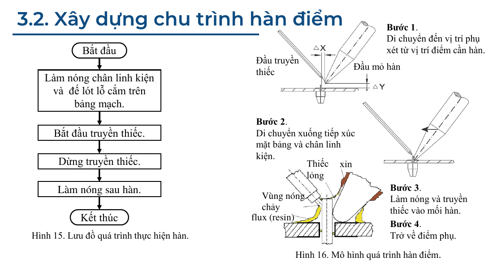

1. From the home pose, jog to the board corners and several reference holes along each row. Save each one as a `robtarget`. Move in straight lines only and touch the surface lightly.
2. Run the RAPID module that writes the saved points to a file.
3. Generate the full grid:

```bash
python data_processing/build_dataset.py --refs refs.txt --board 5x7 --output dataset.txt
```

The script extracts x, y, z from each `robtarget`. It estimates the real hole pitch, which is not exactly 2.54 mm because of measurement angle, tilt and jog resolution. It replaces outliers with the averaged estimate, fills in every remaining hole and writes the points in RAPID syntax.

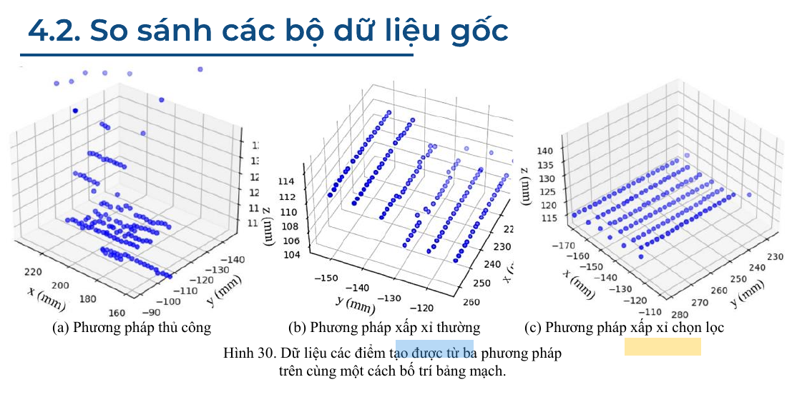

| Method | Δx | Δy | Δz | ε(x) | Wrong-position rate y / z / mean |
| --- | --- | --- | --- | --- | --- |
| Manual teaching | 1.2346 | 0.2713 | -0.0212 | 1.3054 | 0.409 / 0.761 / **0.585** |
| Plain approximation | 1.9523 | -0.0689 | -0.1047 | 0.5878 | 0.227 / 0.280 / **0.254** |
| Selective approximation | 2.5180 | -0.0046 | 0.0065 | **0.0215** | 0.129 / 0.076 / **0.102** |

Δ is the mean distance between consecutive points in a row (mm), and ε(x) is the mean pitch error. With the generated dataset, the arm moves smoothly between joints, without pose changes, pauses or pin collisions.

| Hand-taught points (left) vs. generated dataset (right), 1.5× speed |
| --- |
| 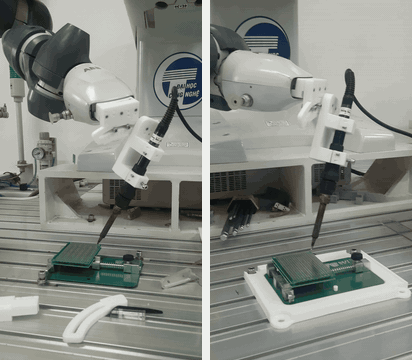 |

### 2.3 Calibration (each time the board is replaced)

The task needs about **0.2 mm** accuracy, and a replaced board never sits exactly where the last one did.

- **XY shift:** touch the new board origin. `shiftXY` is the mean offset from the stored origin, and it is added to every point.
- **Z height:** similar to bed levelling on a 3D printer. Touch the tip to the surface at several points until it just makes contact without pressing. Store the mean as the constant `calibratedZ`. YuMi only reports a collision after the board tilts about 2 mm, so the height must be set carefully when the iron is hot.

```
newPointXY = oldPointXY + shiftXY + offset    ! offset = hole spacing
newPointZ  = calibratedZ + PinLength
```

Re-setup takes **about 4 minutes**. Re-teaching every point by hand used to take hours.

---

## 3. Working procedure

### 3.1 Select the joints to solder

Open `web_pcb_selector/index.html` and choose a board size (3×7, 4×6, 5×7, 6×8, 7×9 or 8×12 cm). Click a hole to select it, or drag to select a whole row. You can undo, clear all or save.

| Board size menu | Selecting joints |
| --- | --- |
| 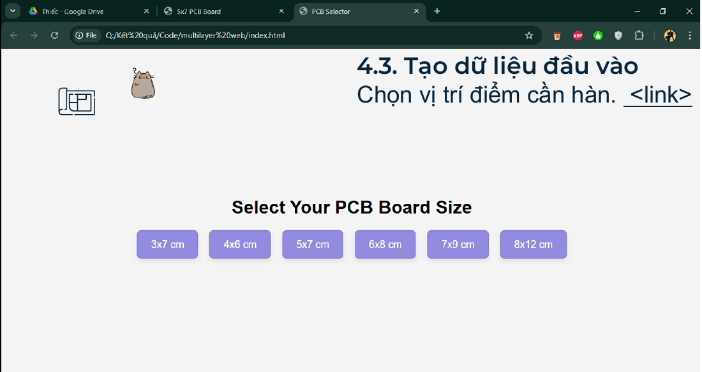 | 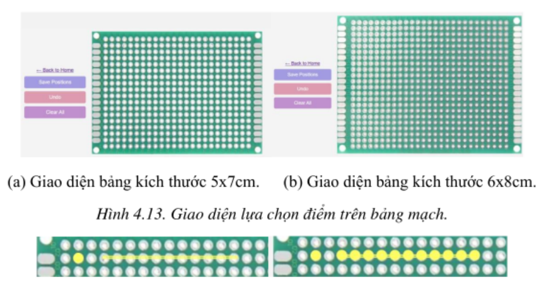 |

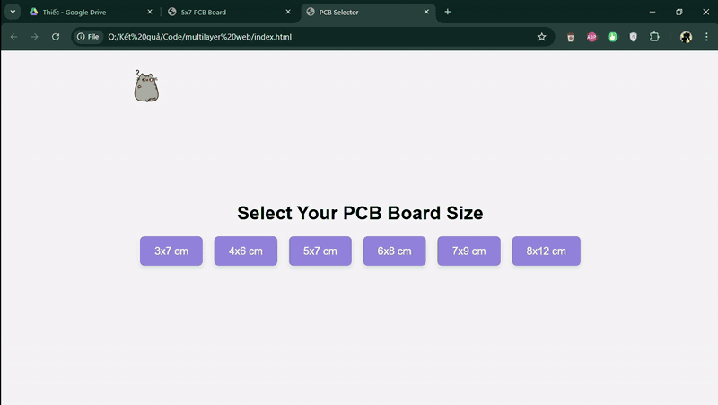

```bash
python data_processing/pixel_to_grid.py --input selection.txt --board 5x7 --output points_grid.txt
```

| Input (pixels x, y) | Output (row, col) |
| --- | --- |
| 65 45 | 2 2 |
| 105 44 | 2 4 |
| 125 44 | 2 5 |
| 146 44 | 2 6 |
| … | … |
| 309 44 | 2 14 |

### 3.2 Optimize the path (ACO / TSP)

```matlab
% MATLAB (used for the reported results)
aco_tsp('points_grid.txt')
```

```bash
# Python
python aco/aco_tsp.py --input points_grid.txt --output order.txt
```

Each ant builds a tour. Pheromones are updated after each iteration, and the shortest tour found is kept. The parameters were tuned on the **TSP Berlin52** benchmark, whose known optimal tour length is 7,542.

| Setting (MATLAB) | Iterations | Ants | α | β | δ | σ | Result |
| --- | --- | --- | --- | --- | --- | --- | --- |
| Initial | 300 | 60 | 1 | 4 | 0.15 | 0.97 | 8,210.2: stuck in a local optimum |
| **Tuned** | 300 | 60 | **15** | **20** | **0.13** | **0.86** | **7,549.0**, converges at about iteration 60 |

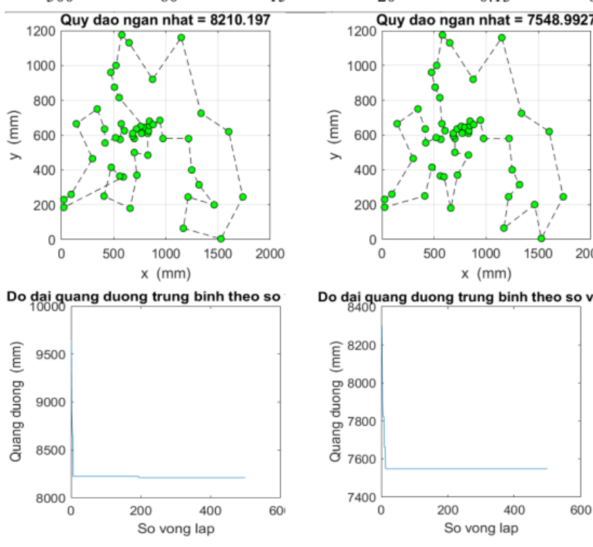

The Python version with local search (60 ants, 100 iterations, α = 15, β = 20, decay 0.1) reaches the optimum of 7,542:

| Unordered (16,751) | ACO (7,542) |
| --- | --- |
|  | 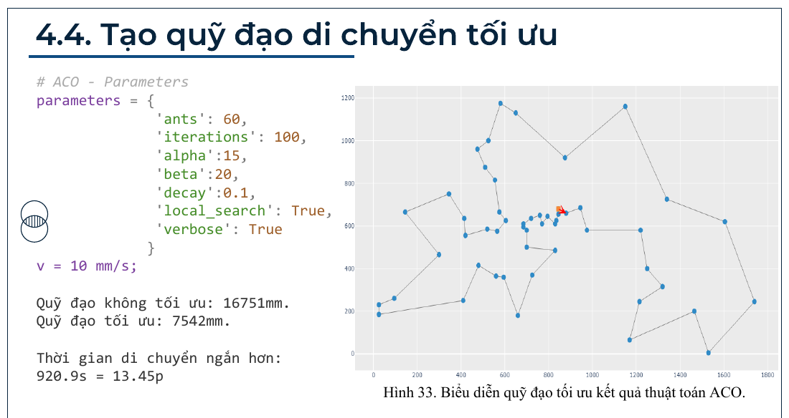 |

**Working parameters for the board:** 20 iterations, 10 ants, α = 15, β = 20, δ = 0.13, σ = 0.86. On 10 random holes the shortest path was **74.14 mm**, found at iteration 4. When joints sit in evenly spaced rows, the order saved from the web page is already optimal, so ACO is only needed for scattered layouts.

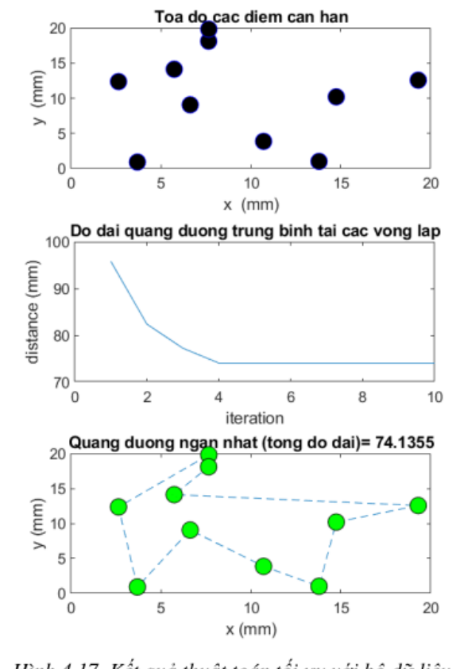

### 3.3 Generate the RAPID program

```bash
python rapid/merge_rapid.py dataset.txt rapid/proc.txt cmd.txt --output output.mod
```

The script merges three files in order: point declarations (`dataset.txt`), the soldering `PROC` (`rapid/proc.txt`), then `main()` (`cmd.txt`), which holds one call per joint in the order from `order.txt` (`[proc name] + [point name]`).

### 3.4 Run on YuMi

1. In RobotStudio, paste or load `output.mod` into the **right-arm module** (`T_ROB_R`).
2. Flash the feeder firmware and connect the YuMi digital output through the 24 → 5 V step-down.
3. Set the iron to **350 °C**, then move to the home pose and run calibration (2.3).
4. Run `main()`. Keep the soldering speed at **`v20` or lower** to limit tip vibration.
5. Clean the tip every **15–20 joints**.

### 3.5 The soldering cycle at one joint

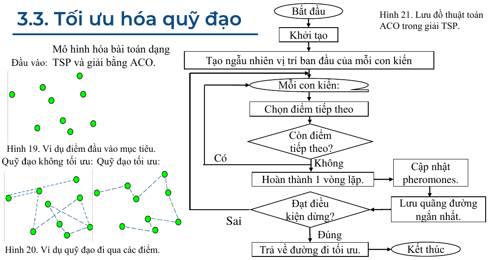

| Close-up along a row (3× speed) | Top-down view (2× speed) |
| --- | --- |
| 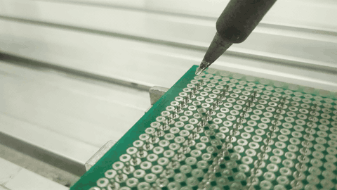 | 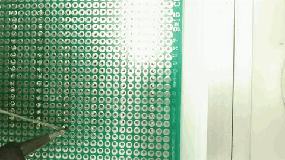 |

Simplified pseudo-code (not runnable RAPID; zones, tool data and semicolons are omitted, and `.xy` stands for setting `x` and `y`). The real routine is in `rapid/proc.txt`.

```
PROC solder(robtarget currentPoint)
    temp.trans.xy         := currentPoint.trans.xy + shiftXY
    temp.trans.z          := calibratedZ + PinLength + clearance
    currentPoint.trans.xy := currentPoint.trans.xy + shiftXY
    currentPoint.trans.z  := calibratedZ + PinLength
    MoveL temp, v50                   ! approach point above the joint
    PulseDO \PLength:=0.3, feed       ! pre-feed: wet the tip
    MoveL currentPoint, v20           ! touch pad + pin
    WaitTime pre_heat                 ! pre-heat pad and pin
    PulseDO \PLength:=0.4, feed       ! feed solder
    WaitTime post_heat                ! let the solder flow
    MoveL temp, v20                   ! retract
ENDPROC
```

| Step | Time |
| --- | --- |
| Wait above joint, wet the tip (DO ON) | 0.1 – 0.4 s |
| Move down to the joint | 0.4 – 0.6 s |
| Pre-heat pad and pin | 1.2 s |
| Feed solder (DO ON) | 0.4 s |
| Post-heat, solder flows (DO OFF) | 0.8 s |
| Retract | 0.2 s |
| **Total per joint** | **≈ 3.2 s** |

---

## 4. Experiments and results

### 4.1 Test case 1: no dataset, no calibration

Setup: iron at 30°, feeder v1, points taught by hand, and solder fed the moment the tip touched the board.

| Trial | Temp. | Wait above | Feed | Wait after |
| --- | --- | --- | --- | --- |
| 1 | 285 °C | 0.5 s | 1.0 s | 0.2 s |
| 2 | 320 °C | 1.0 s | 1.5 s | 0.8 s |

**Result:** 22 of 40 joints (**55 %**) were empty. The board and tip were too cold for the solder to flow, and the tool pose drifted between points. Some joints also landed between pins because of position errors.

### 4.2 Test case 2: effect of temperature

Setup: dataset and calibration in use, pre-heat 1.5 s, feed 0.65 s, post-heat 1.0 s, 85 joints per temperature (5 rows × 17).

| Temp. | Excess | Insufficient | Skipped | Spike | Burnt | Defect rate |
| --- | --- | --- | --- | --- | --- | --- |
| 285 °C | 3 | 12 | 1 | 0 | 2 | 22.1 % |
| 300 °C | 2 | 8 | 1 | 0 | 0 | 10.7 % |
| 320 °C | 9 | 10 | 1 | 0 | 0 | 23.5 % |
| **350 °C** | 2 | 4 | 0 | 0 | 0 | **7.1 %** |
| 385 °C (run 1) | 1 | 8 | 1 | 3 | 3 | 18.6 % |
| 385 °C (run 2) | 4 | 16 | 3 | 1 | 4 | 31.4 % |

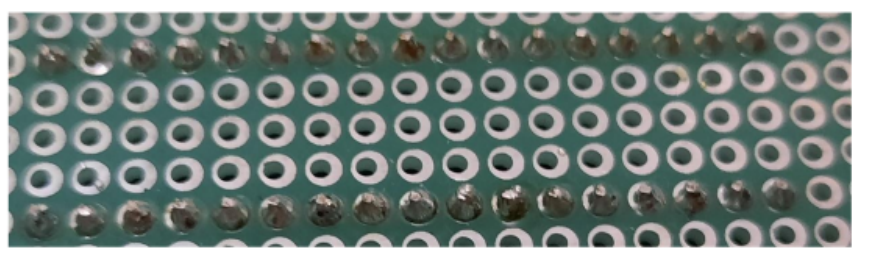

**Heat build-up.** The tip gets hotter during a long run. Joints soldered later in a row (shown at a 400 °C setting, left to right) become duller and burn more easily. Use **320–350 °C** and clean the tip every 15–20 joints.

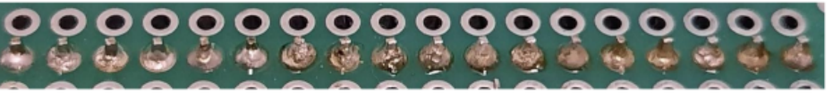

### 4.3 Test case 3: feed time

Setup: 350 °C, pre-heat 1.5 s, feed speed 6 mm/s, post-heat 0.8 s, 72 joints. A short pre-feed was added to wet the tip, so solder reaches both sides of the pin.

| Pre-feed | Feed | Excess | Insufficient | Skipped | Spike | Short | Total defects |
| --- | --- | --- | --- | --- | --- | --- | --- |
| 0.7 s | 1.0 s | 27 | 0 | 0 | 0 | 1 | 29 |
| 0.5 s | 0.8 s | 13 | 7 | 1 | 0 | 0 | 21 |
| **0.3 s** | **0.4 s** | 0 | 18 | 0 | 1 | 0 | **19** |

A typical joint needs about 2 mm of wire, while a 0.7 s pre-feed pushes about 4.5 mm, which explains the excess solder.

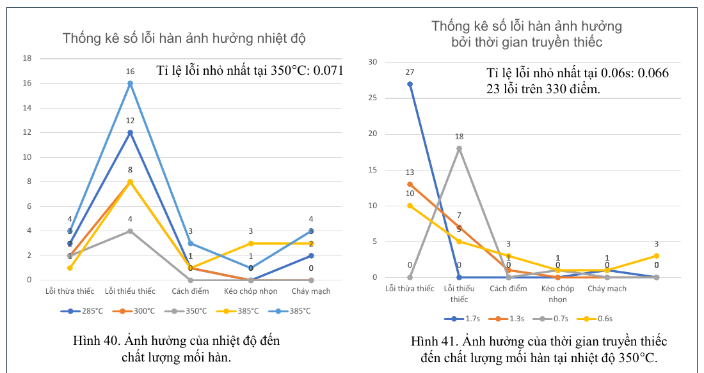

### 4.4 Test case 4: final parameters

Final setup: feeder v2, 350 °C, pre-feed 0.5 s, pre-heat 1.5 s, feed 0.6 s at 4 mm/s, post-heat 0.8 s, and tip cleaning between rows. 330 joints were soldered (22 rows × 15) for each pin length.

| Pin length | Excess | Insufficient | Skipped | Spike | Short | Burnt | Total defects |
| --- | --- | --- | --- | --- | --- | --- | --- |
| 2 mm | 10 | 5 | 3 | 1 | 1 | 3 | 23 |
| 4 mm | 5 | 17 | 0 | 0 | 16 | 4 | 42 |

For short-pin components the overall defect rate is **6.69 %**. Excess solder dropped to **0.33 %**, down from about 30 % in earlier tests. Burnt joints were almost eliminated.

| Short-pin components | Long-pin (4 mm) components |
| --- | --- |
| 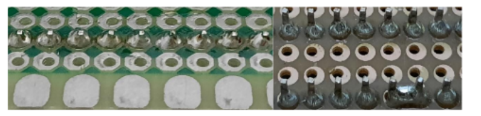 | Long pins limit the tip's contact angle with the pad and conduct heat toward neighbours, which causes bridging and one-sided joints. |

---

## 5. Limitations and future work

**Limitations**
- There is no temperature sensor. Heat is controlled only through the soldering station setting and timing.
- The quality scale does not yet fully follow industrial criteria such as IPC-A-610.
- Tests used perfboards only, not designed production PCBs.

**Future work**
- A friendlier user interface
- A dedicated CNC-style feeder built for high temperatures
- Active heating with closed-loop temperature sensing
- Camera-based joint localization, collision warnings and motion planning
- ML-based automated optical inspection (AOI) of joints from optical or X-ray images

---

## Citation

```
Nguyen Huyen Trang, "Research and development of through-hole component soldering
on printed circuit boards for the YuMi collaborative robot," B.Eng. thesis,
VNU University of Engineering and Technology, Hanoi, 2024.
```

## License

This project is licensed under the [MIT License](LICENSE).
